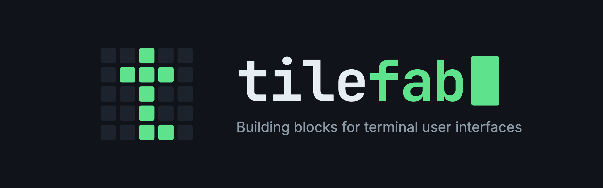

  

**tilefab** builds small, focused building blocks for terminal user interfaces (TUI), written in Rust.

## Projects

| Project | Description | Status |
|---|---|---|
| [tilefab](https://github.com/tilefab/tilefab) | Interactive console: concurrent logs, progress bars and a readline-style prompt | 🚧 In progress |

## Principles

- **Small and composable**: each crate does one thing well.
- **Light on dependencies**: built on [crossterm](https://github.com/crossterm-rs/crossterm).
- **Terminal-friendly**: works over SSH, degrades gracefully in pipes.
